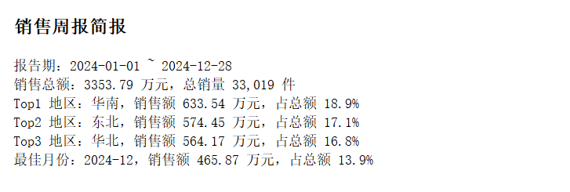
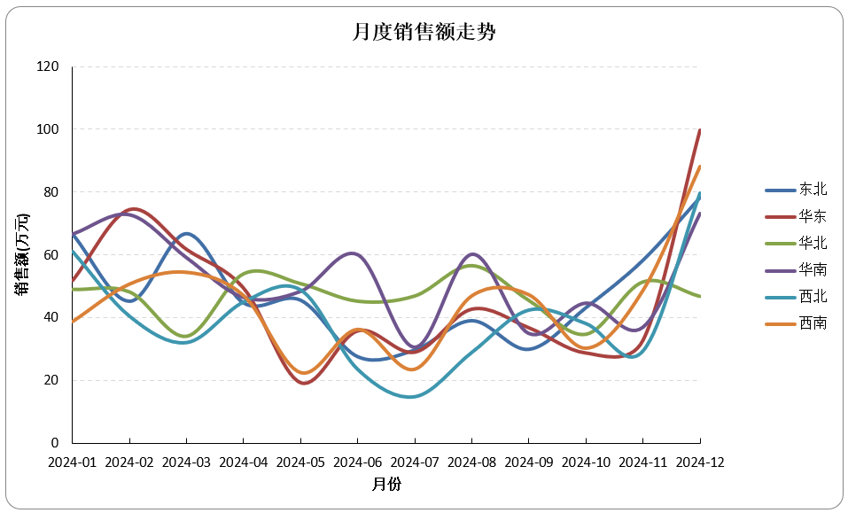

# 销售周报自动化：一条命令出简报 + 透视表 + 原生图表（含数字自洽对账与质量报告）

> 读取、清洗、合并、透视、图表、简报一条命令完成。简报数字与透视表断言对账，对不上直接终止不产出；质量报告账目自洽：读入行数 = 输出行数 + 缺失/重复解释，剔除了多少缺失、多少重复，全部写入报告。

## 解决什么问题

手工拼周报时，时间基本耗在数据和数字上：

- 多个文件列名五花八门：日期、销售日期、订单日期混着用，手动统一费时且易漏
- 日期格式三种写法并存（`2024年1月5日` / `2024/1/5` / `2024.1.5`），Excel 排序直接乱
- 简报结论靠人肉从表里挑数，抄错一个数，全月汇报跟着错
- 某个文件坏了整条流程就崩，或者反过来被悄悄跳过，缺了数据没人知道
- 报表里的数字对不上时说不清是谁的责任：是源数据缺、是清洗剔了、还是汇总算错

**上述每个问题在本项目中都有对应机制**：列名先标准化再过别名表（中英文均可命中）；日期统一解析、失败计数不中断；简报数字全部由代码从清洗后数据现算，写入前与透视表合计做断言对账（差 0.01 以上即终止）；坏文件跳过并登记失败清单，剔了几行、去了几重全部写入质量报告，账目公式校验不平时 `sys.exit`。

## 输入 / 输出

**输入**：`dirty_data/` 目录下的 Excel（.xlsx / .xls）与 CSV 文件，数量不限，列名不要求一致。五个标准字段及常见别名：

| 标准字段 | 认识的写法（节选） |
|---|---|
| 日期 | 日期 / 销售日期 / 订单日期 / 统计日期 / date |
| 地区 | 地区 / 区域 / 大区 / 省份 / city |
| 产品 | 产品 / 商品名称 / 品类 / sku |
| 销售额 | 销售额 / 金额 / 营业额 / revenue |
| 数量 | 数量 / 销量 / 件数 / qty |

别名表外的列名会被丢弃并按缺失计入报告，不做猜测性匹配。

**输出**（运行时自动生成）：

- `output/销售周报_YYYYMMDD.xlsx`，含 4 个工作表：
  - **简报**：报告期、总销售额、总销量、Top3 地区及占比、最佳月份及占比
  - **原数据**：清洗合并后的全部明细
  - **透视表**：月份 × 地区销售额汇总，带行列合计
  - **图表**：各地区销售总额柱状图 + 月度走势折线图（Excel 原生图表，引用透视表区域，可直接编辑）
- `docs/report.txt`：数据质量报告（每次运行覆盖刷新）






## 怎么运行

```powershell
# 1. 创建虚拟环境并安装依赖
python -m venv .venv
.venv\Scripts\activate
pip install -r requirements.txt

# 2. 运行
python main.py
```

运行环境：**Python 3.9 及以上** / Windows（读取 .xls 与 .xlsx 使用 calamine 引擎，需要 pandas 2.2+；本机实测 Python 3.9 + pandas 2.3.3 + openpyxl 3.1.5）。把数据文件放进 `dirty_data/` 后执行 `python main.py`，终端打印分步清洗统计，质量报告全文落在 `docs/report.txt`，报表落在 `output/`。

## 数字自洽机制

本项目的核心保障是三层账，任何一处数字都能对回原数据：

1. **清洗账目**：合并行数 = 输出行数 + 缺失剔除 + 重复剔除。公式不成立直接 `sys.exit`，不存在"数字悄悄少了"
2. **简报对账**：`assert abs(简报总额 - 透视表Total×Total格) < 0.01`，断言失败程序终止，不会产出一份数字有问题的报表
3. **图表零拷贝**：图表不复制数据，直接引用透视表单元格区域——透视表改一个数，图表跟着变，杜绝"图和表不一致"

实测口径（演示数据）：报告期 2024-01-01 至 2024-12-28，总销售额 3353.79 万元，总销量 33,019 件，Top3 地区为华南（18.9%）、东北（17.1%）、华北（16.8%）。

## 数据质量保障机制

- [x] 列名标准化 + 别名表统一，匹配按字段名不按列位置
- [x] 日期多格式解析（年月日 / 斜杠 / 点），失败置 NaT 并计数，不中断
- [x] `to_numeric(errors="coerce")` 收编数值列，混入的「暂无 / -」计数后剔除
- [x] 只剔除关键字段缺失的行，剔多少行报告里写明
- [x] 归一化后再联合去重（keep=first），「华东（大区）」与「华东」判为同区
- [x] 质量报告账目自洽校验，不平时终止
- [x] 坏文件 / 空文件跳过并登记失败清单，其余文件照常处理
- [x] 输出文件被占用时显式退出提示，不产出半成品

## 目录结构

```
04_report_automation/
├── README.md
├── requirements.txt     # 依赖清单（python-calamine 为字符串参数引用，需手动维护）
├── main.py              # 全部逻辑：清洗合并 / 透视 / 图表 / 简报 / 对账
├── dirty_data/          # 输入：销售明细文件（xlsx / xls / csv）
├── output/              # 产出：销售周报_日期.xlsx
└── docs/                # 数据质量报告 report.txt（每次运行刷新，不入库）
```

## 已知限制

- 报表金额全局换算为**万元**（读入后统一除以一万），「原数据」工作表与源文件数值相差一万倍，核对时需注意（本 README 与简报均有标注）
- `docs/report.txt` 为覆盖写入，只保留最近一次运行的质量报告，不留历史
- calamine 引擎要求 pandas 2.2+，旧版 pandas 会报 `Install calamine`
- 别名表未覆盖的新列名会被按缺失剔除并计入报告；接入新来源时需人工补充别名表
- 写 Excel 为逐格写入，行数越大耗时越长，属正常现象而非卡死
- 简报对账容差为 0.01（万元口径，即 100 元），金额出现分项与合计差 100 元以上会触发终止——这是刻意设计，不是 bug

## 联系方式

有类似的数据分析需求，或想让我按你的数据定制分析报告，欢迎联系：

- 📮 邮箱：1182618567@qq.com
- 💬 微信：wx_mokong-J

**我还能帮你做**
- 📊 多份 Excel 合并 / 清洗 / 透视分析
- 📈 数据可视化与趋势分析报告
- 🤖 报表自动化：每周手动做的表，一键生成
- 🕷️ 公开数据采集（合规范围内）

**交付标准**：含数据质量报告 + 非技术人员能看懂的使用说明 + 1 个月免费 bug 修复

## 许可证

MIT License — 可自由使用和修改，保留署名即可。
